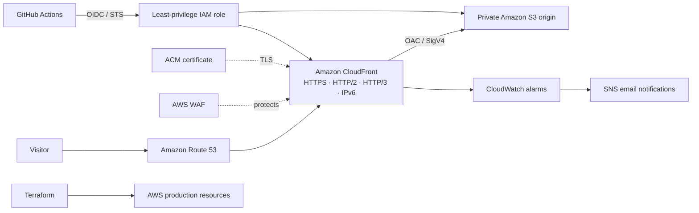

# Alex Pavlyukovets — Cloud & DevOps Portfolio

[](https://github.com/alexpavlyukovets/alexpavlyukovets.github.io/actions/workflows/portfolio.yml)

**Live site:** [https://alexpav.click](https://alexpav.click)

## Project overview

This repository contains the source code and delivery configuration for a static, single-page Cloud & DevOps portfolio. It presents Alex Pavlyukovets' practical development background, current Cloud & DevOps focus, selected public projects, and the production delivery architecture behind the site.

## Engineering highlights

- Private Amazon S3 origin, delivered only through CloudFront Origin Access Control (OAC).
- HTTPS delivery with ACM, Route 53, HTTP/2, HTTP/3, IPv6, AWS WAF, and CloudFront security response headers.
- GitHub Actions CI/CD with SHA-pinned actions, artifacts, GitHub OIDC, AWS STS, least-privilege IAM, and CloudFront invalidation.
- 20 Terraform-managed AWS resources with encrypted, versioned S3 remote state and native S3 state locking.
- CloudWatch CloudFront error-rate alarms with SNS notifications.
- Strict TypeScript React frontend with accessibility, SEO, automated tests, and zero known npm vulnerabilities at the last QA run.

## Technology stack

- React 18 and TypeScript (strict mode)
- Vite static build
- CSS with responsive and reduced-motion support
- ESLint and Prettier
- Vitest and React Testing Library
- Amazon S3, CloudFront, Route 53, ACM, AWS WAF, IAM, CloudWatch, and SNS
- Terraform, GitHub Actions, GitHub OIDC, AWS STS, and Dependabot

## Architecture



See [Architecture](docs/architecture.md) for request and deployment flows.

## Repository structure

```text
.
├── frontend/           # Static React application and test suite
├── infrastructure/     # Terraform-managed AWS delivery infrastructure
├── .github/workflows/  # CI quality gates and production deployment workflow
├── scripts/            # Reserved for project automation
└── docs/
    ├── architecture.md      # Production AWS architecture
    └── frontend-security.md # Frontend CSP and browser-security notes
```

## Local development

```bash
cd frontend
npm ci
npm run dev
```

## Testing

```bash
cd frontend
npm run lint
npm run typecheck
npm run test:ci
```

## Production build

```bash
cd frontend
npm run build
npm run preview
```

The production-ready static output is created in `frontend/dist/`. It has no backend runtime dependency.

## Production AWS architecture

The delivery path is: Developer → GitHub Repository → GitHub Actions → private Amazon S3 origin → Amazon CloudFront → End User. Terraform manages 20 resources for S3, CloudFront, Origin Access Control, Route 53, ACM, AWS WAF, IAM/OIDC, CloudWatch alarms, and SNS notifications. See [the architecture documentation](docs/architecture.md) for boundaries and implementation notes.

## CI/CD workflow

GitHub Actions runs:

```bash
cd frontend
npm ci
npm run lint
npm run typecheck
npm run test:ci
npm run build
```

The workflow authenticates to AWS through GitHub OIDC, uploads `frontend/dist/` to the private S3 origin without deleting existing assets, uploads `index.html` last, invalidates CloudFront, and runs a production smoke test. GitHub Actions are pinned by commit SHA and Dependabot maintains npm and Actions updates.

## Current project status

The portfolio is deployed as a static application. A verified LinkedIn profile and a downloadable CV have not been added because their URLs/files are not present in the repository.

## Verified frontend QA

The following results were measured against a **local production build** at commit [`bb334ba`](https://github.com/alexpavlyukovets/alexpavlyukovets.github.io/commit/bb334ba), not against the live AWS website.

| Metric | Result |
| --- | ---: |
| Lighthouse Performance | 100 |
| Lighthouse Accessibility | 100 |
| Lighthouse SEO | 100 |
| Lighthouse Best Practices | 100 |
| FCP | 1.2 s |
| LCP | 1.4 s |
| CLS | 0 |
| TBT | 0 ms |
| Production build size | 252K |
| Automated tests | 3/3 passed |
| npm audit | 0 known vulnerabilities at time of testing |
| Optimized WebP image | 52,386 bytes |
| Previous JPEG image | 347,177 bytes |

Chromium desktop, tablet, and mobile were verified. Firefox verification was incomplete because of environment restrictions; WebKit was unavailable. No prior Lighthouse baseline and no independent browser console collector were available.

## Technical documentation

- [Architecture](docs/architecture.md)
- [Terraform operations and state](docs/terraform.md)
- [CI/CD workflow](docs/cicd.md)
- [Security controls](docs/security.md)
- [Frontend security and CSP recommendation](docs/frontend-security.md)
- [Operational runbook](docs/runbook.md)
- [Cost notes](docs/costs.md)
- [Infrastructure directory notes](infrastructure/README.md)
- [Workflow directory notes](.github/workflows/README.md)
- [Scripts directory notes](scripts/README.md)
