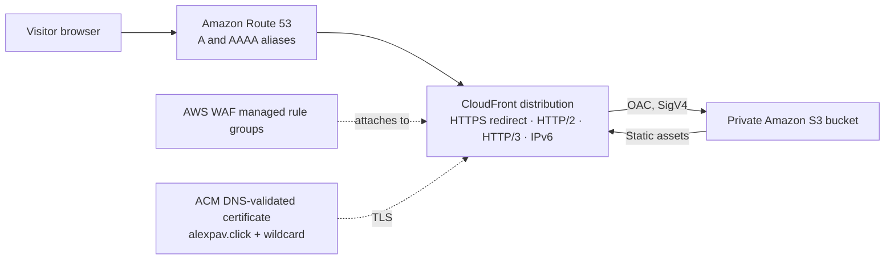
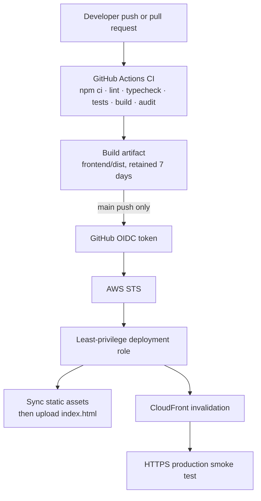

# Production AWS architecture

## Purpose

The portfolio is a client-side React single-page application. It is built into static assets and does not require a backend, database, server-side rendering, or a permanently running Node.js process.

## Visitor request flow

CloudFront is configured with `redirect-to-https`, the `TLSv1.2_2021` minimum protocol policy, HTTP/2 and HTTP/3, IPv6, compression, and a managed security response headers policy. Route 53 resolves the public domain; ACM provides the DNS-validated certificate. OAC signs CloudFront requests to the private S3 origin with SigV4.

## Deployment flow

The deployment role trust policy is restricted to the repository's `main` branch. Feature branches and pull requests execute CI but do not receive deployment credentials.

## Security and operations

- GitHub Actions uses GitHub OIDC and AWS STS to assume a least-privilege IAM role instead of storing long-lived AWS access keys.
- S3 Block Public Access is enabled; CloudFront is the public delivery path.
- CloudWatch alarms monitor CloudFront 4xx and 5xx error rates, with SNS email notifications.
- Terraform manages 20 AWS resources, including encrypted and versioned S3 remote state with native S3 state locking.
- AWS WAF is associated with the CloudFront distribution; CloudFront uses managed security response headers.
- GitHub Actions are SHA-pinned and Dependabot maintains npm and Actions updates.
- Secrets, tokens, private keys, and production credentials must not be stored in this repository.

## Platform components

| Area | Implemented control |
| --- | --- |
| Origin | Private Amazon S3 bucket with Block Public Access, BucketOwnerEnforced ownership, SSE-S3 encryption, and OAC-only reads. |
| Edge | CloudFront with OAC, HTTPS redirect, HTTP/2, HTTP/3, IPv6, compression, managed cache policy, and security response headers. |
| DNS and TLS | Route 53 hosted zone, A and AAAA aliases, ACM RSA-2048 certificate, and DNS validation record. |
| Edge protection | AWS WAF web ACL with Amazon IP reputation, common rule set, and known bad inputs managed groups. |
| Deployment identity | GitHub OIDC provider, AWS STS `AssumeRoleWithWebIdentity`, and a least-privilege IAM role. |
| Observability | CloudWatch 4xx and 5xx error-rate alarms with SNS ALARM and OK notifications. |
| Cost plan | CloudFront Free Flat-Rate Plan subscription associated with the distribution, WAF ACL, and hosted zone. |

## Responsibility boundaries

| Area | Responsibility |
| --- | --- |
| Frontend | React source, static build, accessibility, SEO metadata, and client-side section navigation. |
| Infrastructure | S3, CloudFront, OAC, Route 53, ACM, IAM/OIDC, monitoring, and infrastructure-as-code state. |
| CI/CD | Quality checks, production build, OIDC authentication, static asset upload, and cache invalidation policy. |

## Static hosting considerations

The current application navigates with fragment links, so it does not require SPA route fallback rules. If client-side path routing is added later, configure a CloudFront custom error response or rewrite so application routes serve `index.html`, while missing static assets continue to return their actual error status.

## Security response headers

The CloudFront distribution references a managed security response headers policy. Production header checks have observed HSTS, `X-Content-Type-Options`, `X-Frame-Options`, `Referrer-Policy`, and XSS protection headers. A Content Security Policy is documented as a frontend recommendation only; it is not currently enforced. See [Frontend security](frontend-security.md).

## Frontend boundary

The frontend remains a static artifact. It does not create, mutate, or require AWS resources at runtime; infrastructure and deployment changes belong to their respective Terraform and GitHub Actions areas.
