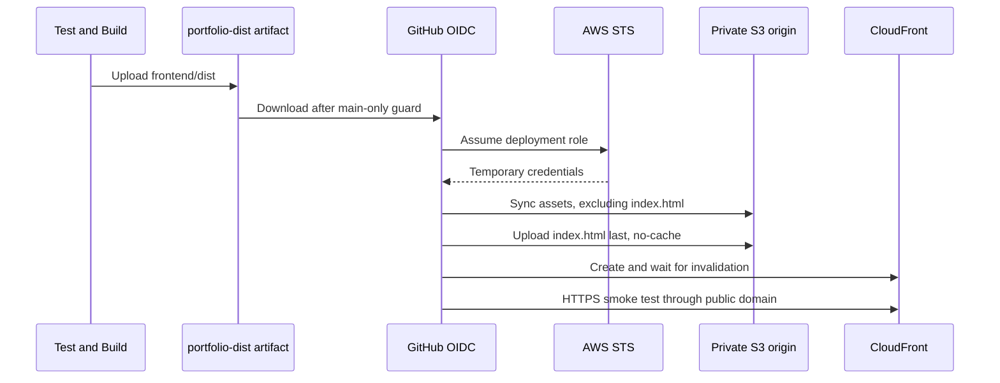

# CI/CD workflow

The workflow is defined in [`.github/workflows/portfolio.yml`](../.github/workflows/portfolio.yml). It separates untrusted change validation from production deployment.

## Triggers and environments

| Event | CI | Deployment |
| --- | --- | --- |
| Push to a feature branch | Yes | No |
| Pull request targeting `main` | Yes | No |
| Push to `main` | Yes | Yes, after CI |
| Manual dispatch | CI available | Deployment still follows the `main` and non-PR guard |

The `deploy` job is explicitly limited to `refs/heads/main` and non-pull-request events. Main-branch protection requires the `Test and Build` status check before integration.

## Quality gates

The `Test and Build` job runs on Ubuntu 24.04 from `frontend/`:

```text
npm ci
npm run lint
npm run typecheck
npm run test:ci
npm run build
npm audit --audit-level=high
```

The workflow uploads `frontend/dist/` as the `portfolio-dist` build artifact for seven days. If the artifact is missing, the job fails.

## Supply-chain controls

- GitHub Actions are pinned by full commit SHA.
- Checkout disables persisted Git credentials.
- Dependabot checks npm dependencies and GitHub Actions weekly.
- The deployment job requests only `contents: read` and `id-token: write`; CI has read-only repository content permission.

## Deployment sequence



The S3 sync command has no delete flag. Deployment therefore does not delete existing S3 assets. It also does not run Terraform or otherwise modify AWS infrastructure. `index.html` is uploaded after other files so it does not reference assets that are not yet present at the origin.

## Identity and authorization

GitHub Actions receives temporary credentials through GitHub OIDC and AWS STS, not long-lived repository secrets. The IAM role trust condition restricts the token subject to the repository's `main` branch. Its policy is limited to listing the portfolio bucket, reading and writing portfolio objects, and creating/reading invalidations for the configured CloudFront distribution.

## Failure handling

If CI fails, correct the change in the feature branch and let CI run again. If deployment fails after CI succeeds, see [Failed GitHub Actions deployment](runbook.md#failed-github-actions-deployment). Do not work around a failed deployment by manually uploading unreviewed local files to S3.
